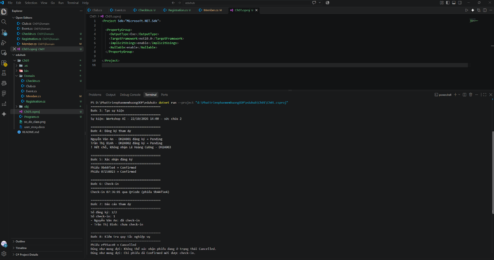
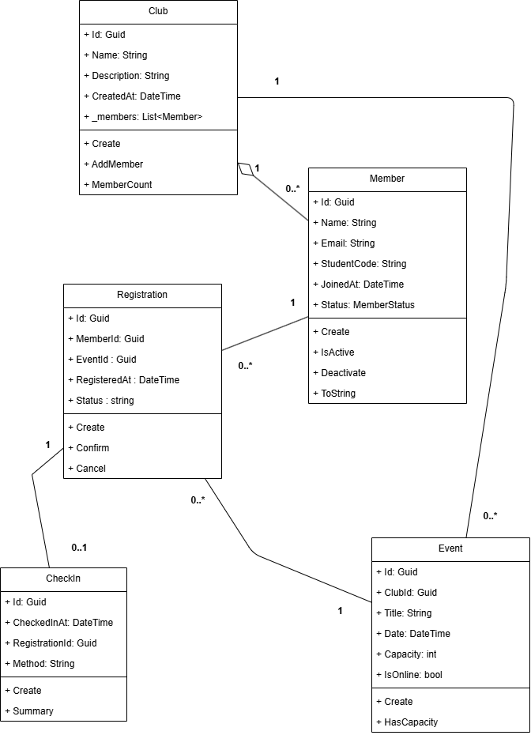

# Ch01 - Quản lý tham dự sự kiện

## Mục tiêu

Chương 01 minh họa cách xây dựng mô hình domain cho câu lạc bộ và quy trình
đăng ký tham dự sự kiện bằng C#/.NET. Các đối tượng domain được tạo thông qua
phương thức `Create()`, sử dụng constructor private và kiểm tra dữ liệu trước
khi khởi tạo.

## Thành phần chính

- `Club`: quản lý thông tin câu lạc bộ và danh sách thành viên.
- `Member`: lưu thông tin thành viên, mã sinh viên và trạng thái hoạt động.
- `Event`: mô tả sự kiện, sức chứa và hình thức tổ chức.
- `Registration`: quản lý phiếu đăng ký với các trạng thái `Pending`,
  `Confirmed` và `Cancelled`.
- `CheckIn`: ghi nhận việc tham dự bằng hình thức `Manual` hoặc `QrCode`.
- `Program.cs`: chạy toàn bộ luồng nghiệp vụ và in báo cáo ra console.

## Luồng chạy thử

Chương trình thực hiện lần lượt các bước:

1. Tạo câu lạc bộ `Tech Club`.
2. Thêm ba thành viên vào câu lạc bộ.
3. Tạo workshop `Workshop AI` với sức chứa tối đa hai người.
4. Đăng ký thành viên tham dự và kiểm tra giới hạn sức chứa.
5. Xác nhận các phiếu đăng ký.
6. Check-in một người bằng mã QR.
7. In báo cáo số lượng đăng ký, số lượng check-in và trạng thái tham dự.
8. Hủy một phiếu đăng ký rồi kiểm tra các quy tắc không cho xác nhận hoặc
   check-in phiếu đã hủy.

## Kết quả chạy thử

Kết quả dưới đây cho thấy chương trình chạy thành công:

- Có `2/2` đăng ký được tiếp nhận theo sức chứa sự kiện.
- Các phiếu đăng ký hợp lệ chuyển từ `Pending` sang `Confirmed`.
- Một người tham dự được check-in bằng `QrCode`.
- Báo cáo phân biệt được người đã check-in và người chưa check-in.
- Phiếu `Cancelled` không thể xác nhận lại.
- Phiếu `Cancelled` không thể check-in.
- Các lỗi nghiệp vụ được bắt và in ra với thông báo `Đúng như mong đợi`.



## Cách chạy

Từ thư mục gốc repository, chạy:

```bash
dotnet run --project Ch01\Ch01.csproj
```

Hoặc mở file `Ch01.csproj` trong Visual Studio Code và chạy project bằng
lệnh `dotnet run`.

## Sơ đồ lớp


