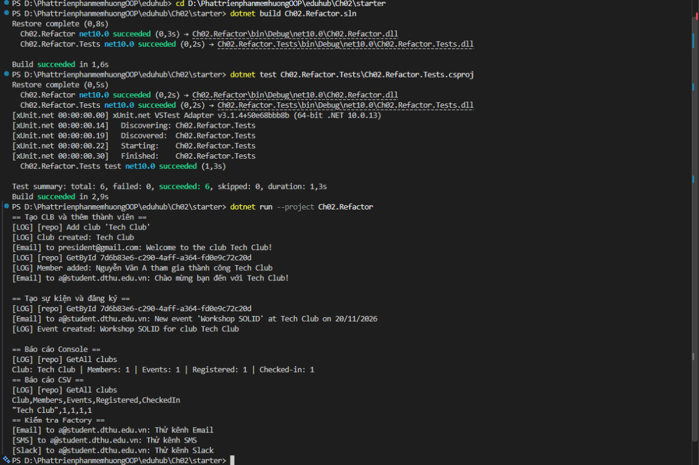

# Tổng hợp Chương 2 - SOLID và Design Patterns

## 1. Mục tiêu của chương

Chương 2 refactor ứng dụng EduHub từ một lớp `ClubManager` kiểu God Class
sang thiết kế tách trách nhiệm theo SOLID.

Các nghiệp vụ chính:

- Quản lý câu lạc bộ.
- Thêm thành viên vào câu lạc bộ.
- Tạo và quản lý sự kiện.
- Đăng ký và check-in sự kiện.
- Gửi thông báo.
- Ghi log.
- Sinh báo cáo câu lạc bộ.

## 2. Những phần đã hoàn thành

### 2.1. Domain

Các quy tắc nghiệp vụ đã được đưa vào Domain:

- `Club.Create`:
  - Không cho phép tên rỗng hoặc chỉ có khoảng trắng.
  - Không cho phép tên dài hơn `Club.MaxNameLength`.
  - Tự tạo `Guid` cho câu lạc bộ.
  - Chuẩn hóa mô tả null thành chuỗi rỗng.
- `Club.HasRoom`:
  - Câu lạc bộ còn chỗ khi số thành viên nhỏ hơn `Club.MaxMembers`.
- `Event.Register`:
  - Trả về `true` khi thành viên đăng ký lần đầu.
  - Trả về `false` khi thành viên đăng ký trùng.
- `Event.CheckIn`:
  - Chỉ cho phép thành viên đã đăng ký check-in.
  - Ném `InvalidOperationException` nếu chưa đăng ký.

File liên quan:

- `Ch02.Refactor/Domain/Club.cs`
- `Ch02.Refactor/Domain/Event.cs`
- `Ch02.Refactor/Domain/Member.cs`

### 2.2. Repository

Đã tách việc lưu trữ dữ liệu khỏi nghiệp vụ:

- `IClubRepository` và `ClubRepositoryImpl`.
- `IMemberRepository` và `InMemoryMemberRepositoryImpl`.
- `IEventRepository` và `InMemoryEventRepositoryImpl`.

Các repository hiện lưu dữ liệu trong bộ nhớ bằng `List<T>`.
Service chỉ phụ thuộc vào interface, không phụ thuộc trực tiếp vào cách lưu trữ.

### 2.3. ClubService

`ClubServiceImpl` phụ trách:

- Tạo câu lạc bộ.
- Thêm thành viên.
- Kiểm tra câu lạc bộ tồn tại.
- Kiểm tra giới hạn thành viên.
- Ghi log thông qua `IAppLogger`.
- Gửi thông báo thông qua `INotificationServiceFactory`.

Logic tạo Club và thêm Member không còn nằm trong luồng chính của
`ClubManager`.

### 2.4. EventService

`EventServiceImpl` phụ trách:

- Tạo sự kiện cho một câu lạc bộ.
- Lưu sự kiện vào repository.
- Đăng ký thành viên vào sự kiện.
- Kiểm tra thành viên thuộc đúng câu lạc bộ.
- Check-in thành viên.
- Phát thông báo cho các Observer khi sự kiện được tạo.
- Đăng ký và hủy đăng ký Observer.

### 2.5. Logging

Đã tạo abstraction `IAppLogger` và các implementation:

- `ConsoleLoggerImpl`: ghi log ra Console.
- `FileLoggerImpl`: ghi log vào file.

Các service không tự ghi file hoặc tự quyết định cách ghi log.

## 3. Design Pattern đã áp dụng

### 3.1. Factory Pattern - Notification

Các file chính:

- `Services/INotificationService.cs`
- `Services/INotificationServiceFactory.cs`
- `Services/Impl/NotificationServiceFactoryImpl.cs`
- `Services/Impl/EMailNotificationServiceImpl.cs`
- `Services/Impl/SMSNotificationServiceImpl.cs`
- `Services/Impl/SlackNotificationServiceImpl.cs`

Factory tạo implementation theo `NotificationChannel`:

```text
NotificationChannel.Email -> EmailNotificationServiceImpl
NotificationChannel.SMS   -> SMSNotificationServiceImpl
NotificationChannel.Slack -> SlackNotificationServiceImpl
```

Muốn thêm kênh mới chỉ cần thêm implementation và cập nhật Factory,
không cần sửa logic nghiệp vụ của `ClubService`.

### 3.2. Decorator Pattern - Logging Repository

File:

- `Repositorys/Impl/LoggingClubRepository.cs`

Luồng hoạt động:

```text
ClubService
    -> LoggingClubRepository
        -> ClubRepositoryImpl
```

`LoggingClubRepository` bọc `IClubRepository`, ghi log khi gọi:

- `Add`.
- `GetById`.
- `GetAll`.

Repository lưu dữ liệu không phải tự biết về logging.

### 3.3. Strategy Pattern - Report

Các file chính:

- `Services/IReportStrategy.cs`
- `Services/IReportService.cs`
- `Services/Impl/ReportServiceImpl.cs`
- `Services/Impl/ConsoleReportStrategy.cs`
- `Services/Impl/CsvReportStrategy.cs`

`ReportServiceImpl` tạo dữ liệu thống kê và giao việc định dạng cho Strategy.

Các định dạng hiện có:

- `ConsoleReportStrategy`.
- `CsvReportStrategy`.

Có thể thêm JSON hoặc HTML bằng cách tạo Strategy mới,
không cần sửa `ReportServiceImpl`.

### 3.4. Observer Pattern - Event

Các file chính:

- `Services/IEventObserver.cs`
- `Services/Impl/EmailNotifierImpl.cs`
- `Services/Impl/LogNotifierImpl.cs`

Khi Event được tạo:

```text
EventServiceImpl
    -> EmailNotifierImpl
    -> LogNotifierImpl
```

`EventServiceImpl` không cần biết Observer cụ thể làm gì.
Observer có thể gửi email, ghi log hoặc được mở rộng thêm cho SMS/Slack.

## 4. Cấu trúc thư mục Chương 2 sau khi refactor

```text
Ch02/
└── starter/
    ├── Ch02.Refactor.sln
    ├── README.md
    ├── CH02-SUMMARY.md
    ├── docs/
    │   └── solid-analysis.md
    │
    ├── Ch02.Refactor/
    │   ├── Ch02.Refactor.csproj
    │   ├── Program.cs
    │   ├── ClubManager.cs
    │   │
    │   ├── Domain/
    │   │   ├── Club.cs
    │   │   ├── Event.cs
    │   │   └── Member.cs
    │   │
    │   ├── Enum/
    │   │   └── NotificationChannel.cs
    │   │
    │   ├── Logging/
    │   │   ├── IAppLogger.cs
    │   │   └── Impl/
    │   │       ├── ConsolelogerImpl.cs
    │   │       └── FileLoggerImpl.cs
    │   │
    │   ├── Repositorys/
    │   │   ├── IClubRepository.cs
    │   │   ├── IEventRepository.cs
    │   │   ├── IMemberRepository.cs
    │   │   └── Impl/
    │   │       ├── ClubRepositoryImpl.cs
    │   │       ├── InMemoryEventRepositoryImpl.cs
    │   │       ├── InMemoryMemberRepositoryImpl.cs
    │   │       └── LoggingClubRepository.cs
    │   │
    │   └── Services/
    │       ├── IClubService.cs
    │       ├── IEventObserver.cs
    │       ├── IEventService.cs
    │       ├── INotificationService.cs
    │       ├── INotificationServiceFactory.cs
    │       ├── IReportService.cs
    │       ├── IReportStrategy.cs
    │       └── Impl/
    │           ├── ClubServiceImpl.cs
    │           ├── ConsoleReportStrategy.cs
    │           ├── CsvReportStrategy.cs
    │           ├── EMailNotificationServiceImpl.cs
    │           ├── EmailNotifierImpl.cs
    │           ├── EventServiceImpl.cs
    │           ├── LogNotifierImpl.cs
    │           ├── NotificationServiceFactoryImpl.cs
    │           ├── ReportServiceImpl.cs
    │           ├── SMSNotificationServiceImpl.cs
    │           └── SlackNotificationServiceImpl.cs
    │
    └── Ch02.Refactor.Tests/
        ├── Ch02.Refactor.Tests.csproj
        └── DomainTests.cs
```

## 5. Dependency Injection trong `Program.cs`

`Program.cs` đóng vai trò Composition Root:

1. Tạo Logger.
2. Tạo Notification Factory.
3. Tạo repository.
4. Bọc `ClubRepositoryImpl` bằng `LoggingClubRepository`.
5. Tạo `ClubServiceImpl`.
6. Tạo `EventServiceImpl`.
7. Tạo `ReportServiceImpl`.
8. Đăng ký Email và Log Observer.
9. Chạy các nghiệp vụ mẫu.

Các repository được dùng chung giữa những service liên quan để dữ liệu tạo
ở `ClubService` có thể được đọc bởi `EventService` và `ReportService`.

## 6. Unit test

File:

- `Ch02.Refactor.Tests/DomainTests.cs`

Các trường hợp đã kiểm thử:

- Tạo Club với tên hợp lệ.
- Tạo Club với tên rỗng.
- Tạo Club với tên vượt quá giới hạn.
- Kiểm tra sức chứa ở mốc 49 và 50 thành viên.
- Đăng ký Event lần đầu.
- Đăng ký cùng một thành viên hai lần.
- Check-in khi chưa đăng ký.

## 7. Kết quả kiểm tra

Đã chạy:

```powershell
dotnet build Ch02.Refactor.sln --no-restore
dotnet test Ch02.Refactor.Tests\Ch02.Refactor.Tests.csproj --no-restore
dotnet run --project Ch02.Refactor --no-build
```

Kết quả:

```text
Build: 0 Error, 0 Warning
Test: Passed 6, Failed 0, Skipped 0
Demo: chạy thành công
```

Demo đã xác nhận:

- Tạo Club và Member.
- Ghi log qua Decorator.
- Gửi thông báo qua Factory.
- Tạo Event.
- Gửi thông báo qua Email Observer.
- Ghi log qua Log Observer.
- Register và Check-in Event.
- Xuất báo cáo Console.
- Xuất báo cáo CSV.

## 8. Các lệnh chạy lại

Từ thư mục `Ch02/starter`:

```powershell
dotnet build Ch02.Refactor.sln
dotnet test Ch02.Refactor.Tests\Ch02.Refactor.Tests.csproj
dotnet run --project Ch02.Refactor
```

## 9. Kết luận

Chương 2 đã chuyển từ thiết kế God Class sang thiết kế có phân tách trách nhiệm:

```text
ClubService       -> nghiệp vụ Club và Member
EventService      -> nghiệp vụ Event
ReportService     -> tổng hợp dữ liệu báo cáo
Repository        -> lưu và truy vấn dữ liệu
Logger            -> ghi log
Factory           -> tạo notification
Decorator         -> thêm logging cho repository
Strategy          -> thay đổi định dạng báo cáo
Observer          -> phản ứng khi Event được tạo
```

Thiết kế mới đáp ứng các mục tiêu chính của SRP, OCP và DIP,
đồng thời minh họa Factory, Decorator, Strategy và Observer.

## 10. Minh chứng chạy chương trình

Ảnh dưới đây là minh chứng chạy thành công Chương 2. Chạy lệnh tại thư mục
chứa solution `Ch02/starter`:

```powershell
cd D:\PhattrienphanmemhuongOOP\eduhub\Ch02\starter
dotnet build Ch02.Refactor.sln
dotnet test Ch02.Refactor.Tests\Ch02.Refactor.Tests.csproj
dotnet run --project Ch02.Refactor
```



Kết quả:

```text
Build succeeded.
0 Warning(s)
0 Error(s)

Passed! - Failed: 0, Passed: 6, Skipped: 0, Total: 6
```
